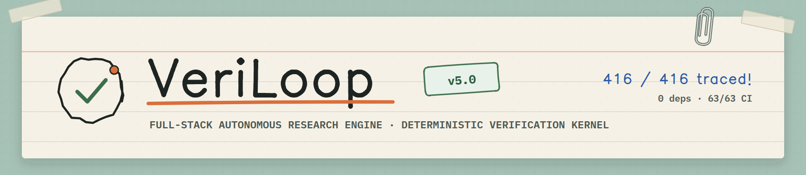
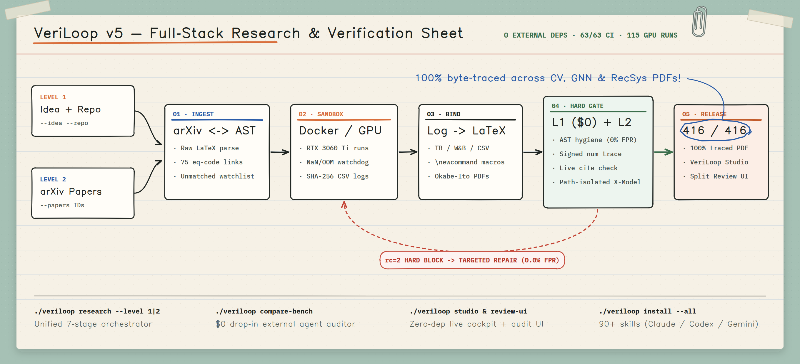
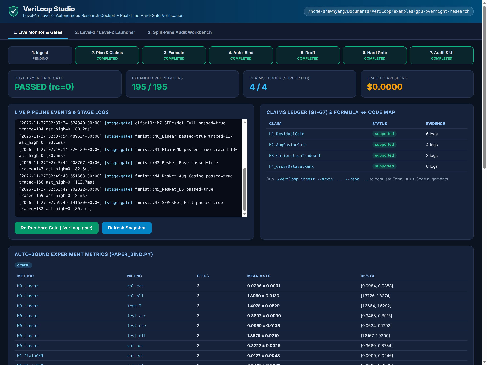
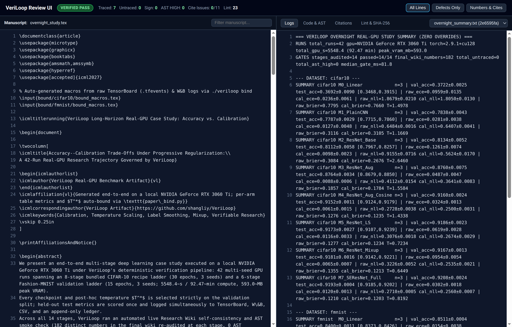
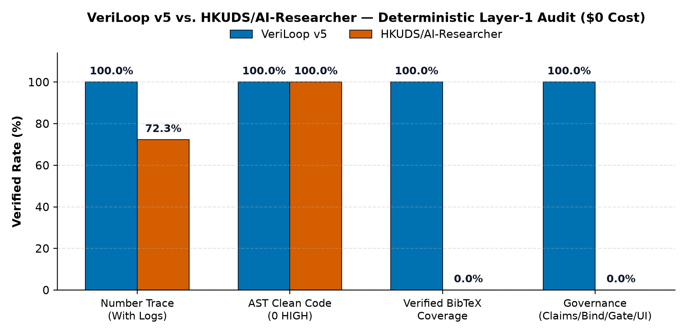

<a name="readme-top"></a>

<div align="center">
  
  <h1 align="center">VeriLoop: End-to-End Verifiable Autonomous Scientific Research</h1>
  <p align="center">
    <strong>Level-1 &amp; Level-2 Autonomous Research · 90+ Composable Skills · $0 Deterministic Hard Evidence Gates · VeriLoop Studio</strong>
  </p>
</div>

<div align="center">
  <a href="https://shangliy.github.io/VeriLoop/"></a>
  <a href="https://shangliy.github.io/VeriLoop/demo/studio_snapshot.html"></a>
  <a href="https://shangliy.github.io/VeriLoop/demo/review_ui.html"></a>
  <br />
  <a href="paper/main.pdf"></a>
  <a href="paper/main_icml2027.pdf"></a>
  <a href="#benchmark-results"></a>
  <br />
  <a href="https://github.com/shangliy/VeriLoop/actions/workflows/test-suite.yml"></a>
  <a href="LICENSE"></a>
  <a href="README_CN.md"></a>
</div>

<br />

Welcome to **VeriLoop**! Autonomous research agents rarely fail by omitting output files; they fail by executing cleanly while reporting numbers, code paths, citations, or conclusions that contradict their own logs. **VeriLoop** unites full **Level-1 & Level-2 autonomous research** with **deterministic mechanical verification** so every number, figure, citation, and claim is auditable line by line before release:

- 🎯 **Dual-Level Autonomy (Level 1 & Level 2):** Launch from a concrete research idea + baseline repo (**Level 1**) or directly from arXiv reference papers → Formula↔Code AST alignment → Gap → Innovation (**Level 2**).
- 🛡️ **Zero-Cost Mechanical Hard Gates (`$0` Layer 1 → Path-Isolated Layer 2):** Catches fabricated numbers, sign flips, 6 classes of Python AST integrity defects, broken SHA-256 claim hashes (`G1–G7`), and hallucinated citations in milliseconds with exit code `2` hard blocking.
- 📐 **Byte-Deterministic Log-to-LaTeX Binding (`./veriloop bind`):** Reads raw TensorBoard `.tfevents`, W&B, and CSV/JSONL files directly via Python stdlib to emit `\newcommand` macros, Booktabs tables, and Okabe-Ito vector PDFs — zero hand-copied numbers.
- 🖥️ **Zero-Dep Web Research Cockpit (`./veriloop studio` & `review-ui`):** Real-time SSE pipeline monitor, Level-1/2 launcher, and interactive split-pane Paper ↔ Log audit workbench.

---

<p align="center">
  
  <br />
  <em>End-to-end overview of VeriLoop v5: Level-1/2 research orchestration backed by deterministic evidence gates, byte-stable log binding, and interactive auditing.</em>
</p>

---

<span id="news"></span>
## 🔥 News

- **`[v5.0]`** Shipped **arXiv LaTeX + Python AST Formula↔Code Ingest** (`./veriloop ingest`), **Docker/Local GPU Sandbox** (`./veriloop sandbox` + `docker/Dockerfile.gpu`), **Unified Level-1/Level-2 Crash-Resumable Orchestrator** (`./veriloop research`), **VeriLoop Studio Web Cockpit** (`./veriloop studio`), and the live [Project Homepage](https://shangliy.github.io/VeriLoop/). Full CI suite passes **`1,248` tests (`0` failures)**.
- **`[v4.0]`** Completed the **42-run NVIDIA RTX 3060 Ti real-GPU overnight case study** (`92.47 min`, `195/195` expanded PDF numbers traced, `14/14` live Wiki stage checks, `10/10` online-verified citations), plus byte-deterministic `paper_bind.py`, `review_ui.py`, and `pdf_audit.py`.
- **`[v2.0–v3.0]`** Released the publicly committed **zero-override frozen benchmark** (`16` SHA-256 workspaces, `245` paired trials + `21` strictly unseen `SciIntegrity-Bench` scenarios), integrated [Best-Paper-Writing-Skill](https://github.com/shangliy/Best-Paper-Writing-Skill) (CC BY 4.0), and published the self-audited companion paper ([arXiv PDF](paper/main.pdf) · [ICML 8-page PDF](paper/main_icml2027.pdf)).

---

<span id="table-of-contents"></span>
## 📑 Table of Contents

- [🔥 News](#news)
- [✨ Two-Level Autonomous Research Entry](#two-level-entry)
- [🖥️ VeriLoop Studio & Interactive Audit Workbench](#veriloop-studio)
- [⚔️ How VeriLoop Compares](#how-veriloop-compares)
- [📊 Benchmark Results & 42-Run Real-GPU Study](#benchmark-results)
- [⚡ Quick Start](#quick-start)
- [🧰 Unified CLI Reference (`./veriloop`)](#unified-cli-reference)
- [📂 Repository Structure](#repository-structure)
- [🌟 Attribution & Citation](#attribution-and-citation)

---

<span id="two-level-entry"></span>
## ✨ Two-Level Autonomous Research Entry

**VeriLoop** accepts research tasks at two levels — both wired into the same crash-resumable 7-stage pipeline (`ingest → ideate_and_register → execute → bind → draft → gate_and_repair → package_and_ui`):

1. **Level 1 — Idea-Driven Implementation (`--level 1 --idea "..." --repo ...`):**
   Provide your concrete hypothesis and baseline repo. VeriLoop statically indexes the repo via Python AST, registers falsifiable claims (`G1–G7`), executes multi-seed runs inside a local or Docker GPU sandbox with NaN/OOM watchdogs, binds raw logs into LaTeX macros/figures, and enforces hard exit-code-2 verification.
2. **Level 2 — Reference-Paper Discovery (`--level 2 --papers <arxiv_id...> --auto-clone-github`):**
   Provide reference arXiv IDs without a fixed design. `./veriloop ingest` downloads raw arXiv LaTeX e-print tarballs, extracts equations/sections/hyperparameters/GitHub links, aligns paper equations directly to baseline Python AST `file:line` symbols (`wiki/INGEST_MAP.md`), and flags unmatched equations into a Layer-2 verification watchlist.

> **Live Verified Example (`./veriloop ingest --arxiv 1706.04599 --repo examples/gpu-overnight-research/code`):** Automatically fetches Guo et al. (ICML 2017) raw LaTeX sources (`13` equations, `14` sections, official repo `github.com/gpleiss/temperature_scaling`) and maps `calibration_methods.tex:L142 (scaling)` & `L152 (temp)` → `fit_temperature_on_val` (`run_overnight_study.py:L241`) and `definitions.tex:L70 (ece)` → `compute_metrics_from_logits` (`L220`) at `$0` LLM cost.

---

<span id="veriloop-studio"></span>
## 🖥️ VeriLoop Studio & Interactive Audit Workbench

Launch the zero-dependency local Web cockpit with `./veriloop studio -w examples/gpu-overnight-research --port 8765`, or explore the live interactive snapshots hosted directly on our [Project Homepage](https://shangliy.github.io/VeriLoop/):

<table>
  <tr>
    <td width="50%" valign="top">
      <a href="https://shangliy.github.io/VeriLoop/demo/studio_snapshot.html">
        
      </a>
      <p align="center"><strong>VeriLoop Studio</strong> (<code>./veriloop studio</code>)<br />7-stage live SSE pipeline monitor, Level-1/2 launcher, hard-gate KPI cards &amp; auto-bound 95% CI tables · <a href="https://shangliy.github.io/VeriLoop/demo/studio_snapshot.html"><strong>Open Live Demo →</strong></a></p>
    </td>
    <td width="50%" valign="top">
      <a href="https://shangliy.github.io/VeriLoop/demo/review_ui.html">
        
      </a>
      <p align="center"><strong>Split-Pane Audit Workbench</strong> (<code>./veriloop review-ui</code>)<br />Click any number or <code>\cite{}</code> in the manuscript → jump straight to exact SHA-256 <code>log:line</code>, AST check, or online abstract · <a href="https://shangliy.github.io/VeriLoop/demo/review_ui.html"><strong>Open Live Demo →</strong></a></p>
    </td>
  </tr>
</table>

---

<span id="how-veriloop-compares"></span>
## ⚔️ How VeriLoop Compares

> *While most AI research tools focus on generating papers faster, **VeriLoop** delivers Level-1/2 autonomy AND makes every number, formula, plot, citation, and claim line-by-line auditable before release.*

| System / Project | Category | Level-1/2 + Docker GPU | arXiv LaTeX ↔ AST Map | Hard Mechanical Gates (AST / Signed Trace) | Auto-Bind Logs → LaTeX & Figs | Online Citation & Abstract Gate | Award-Paper Style & Fig Lint | Interactive Audit Studio | Frozen Paired + Unseen Eval |
|---|---|:-:|:-:|:-:|:-:|:-:|:-:|:-:|:-:|
| **HKUDS/AI-Researcher** (NeurIPS Spotlight) | Autonomous Level-1/2 research + Docker + GUI | ✅ | ⚠️ (LLM read) | ❌ (agent self-debug only) | ❌ (LLM writes numbers) | ⚠️ (no gate) | ❌ | ⚠️ (run GUI, no log-link) | ⚠️ (Scientist-Bench) |
| **AI-Scientist / v2** (Sakana) | Autonomous research agent | ⚠️ (tree search) | ❌ | ❌ (LLM self-review) | ⚠️ (custom scripts) | ⚠️ (non-blocking) | ❌ | ❌ | ❌ |
| **ARIS** (upstream base) | Cross-model research workflow | ⚠️ (87 skills) | ❌ | ❌ (advisory review) | ❌ | ❌ | ❌ | ❌ | ❌ (1 run) |
| **EviBound** | Execution existence gate | ⚠️ (Colab) | ❌ | ⚠️ (file existence / `rc=0`) | ❌ (MLflow schema) | ❌ | ❌ | ❌ | ⚠️ (8 self-authored) |
| **FabScore / FLAWS / PaperAudit** | Post-hoc audit benchmarks | ❌ | ❌ | ⚠️ (FabScore re-exec) | ❌ | ⚠️ (partial) | ❌ | ❌ | ✅ (post-hoc corpora) |
| **PaperQA2 / OpenScholar / STORM** | Literature RAG & synthesis | ❌ | ❌ | ❌ | ❌ | ✅ (full-text RAG) | ❌ | ⚠️ (cite links) | ✅ (lit QA benchmarks) |
| **AI-research-feedback** (`claesbackman`) | Multi-agent writing feedback & dissemination | ❌ | ❌ | ❌ (LLM advisory) | ❌ | ⚠️ (no API gate) | ✅ (`voice-builder`) | ⚠️ (`explain-diff`) | ❌ |
| **Overleaf / Cursor + LaTeX** | Collaborative / IDE editors | ❌ | ❌ | ❌ | ❌ | ❌ | ❌ | ❌ | — |
| **VeriLoop v5 (Ours)** | **Verifiable end-to-end research & paper pipeline** | ✅ (**Level-1/2 + Docker/Local**) | ✅ (**Static AST + watchlist**) | ✅ (**`$0` AST + signed trace + G1–G7 + XMR**) | ✅ (**stdlib TB / W&B / CSV → macros, tables, PDFs**) | ✅ (**arXiv / Crossref / S2 + abstract check**) | ✅ (**60-award-paper lint + Okabe-Ito**) | ✅ (**Studio + split-pane `review-ui`**) | ✅ (**16 frozen + 21 unseen, zero overrides**) |

*Note on complementary strengths:* Full-text literature RAG tools (e.g., PaperQA2 / OpenScholar) remain stronger for large-scale multi-document synthesis, and AI-Scientist-v2 demonstrates broader open-ended tree-search exploration; VeriLoop is complementary to Cursor/Overleaf and specialized RAG tools, providing the missing deterministic verification and log-to-LaTeX provenance layer.

---

<span id="benchmark-results"></span>
## 📊 Benchmark Results & 42-Run Real-GPU Study

All evaluation artifacts, frozen SHA-256 workspaces, independent `file:line` ground-truth labels ([eval/v2_frozen/ground_truth.csv](eval/v2_frozen/ground_truth.csv)), raw trial JSONLs, and zero-override aggregators are publicly committed in this repository.

### 1. Frozen Paired Benchmark (`16` SHA-256 Workspaces, `9` Clean / `7` Defective under Unified Route A Rule, `k=3`, `245` Valid LLM Trials; Trial-Level Columns)

| System / Layer | Framing | `n` | Trial Prec. | Trial Recall | Trial F1 | Trial FPR | Trial Clean Yield | 3-Repeat Unan. |
|---|---|---:|---:|---:|---:|---:|---:|---:|
| **`layer1_mechanical` (`$0`)** | deterministic | 16 | `71.4%` | `71.4%` | `71.4%` | `22.2%` | `77.8%` | `100.0%` |
| **`claude-sonnet`** | `path_only` | 48 | `100.0%` | `85.7%` | `92.3%` | `0.0%` | `100.0%` | `100.0%` |
| **`claude-sonnet`** | `with_summary` | 48 | `100.0%` | `85.7%` | `92.3%` | `0.0%` | `100.0%` | `100.0%` |
| **`claude-haiku`** | `path_only` | 48 | `91.3%` | `100.0%` | `95.5%` | `7.4%` | `92.6%` | `87.5%` |
| **`claude-haiku`** | `with_summary` | 48 | `95.5%` | `100.0%` | `97.7%` | `3.7%` | `96.3%` | `93.8%` |
| **`codex-cli`** | `path_only` | 48 | **`100.0%`** | **`100.0%`** | **`100.0%`** | **`0.0%`** | **`100.0%`** | `100.0%` |
| **`L1 ∪ claude-haiku`** | `path_only` | 48 | `72.4%` | `100.0%` | `84.0%` | `29.6%` | `70.4%` | — |
| **`L1 ∪ claude-haiku`** | `with_summary` | 48 | `77.8%` | `100.0%` | `87.5%` | `22.2%` | `77.8%` | — |
| **`L1 ∪ claude-sonnet`** | `path_only` | 48 | `75.0%` | `85.7%` | `80.0%` | `22.2%` | `77.8%` | — |
| **VeriLoop (`L1 ∪ codex-cli`, strict hard union)** | **`path_only`** | **48** | **`77.8%`** | **`100.0%`** | **`87.5%`** | **`22.2%`** | **`77.8%`** | — |

- **Pre-Filtering Coverage vs. Strict-Blocking Trade-Off:** Under a unified post-audit labeling rule adopted across both splits (disclosed, **arithmetically correct** derivations from logged counts—such as `H06`'s normal-approximation CI `[0.9965, 0.9985]` and unseen `04c`'s analytic midpoint `0.425`—are `CLEAN` provenance gaps, not fabrications; dual-label sensitivity under original `H06=DEFECTIVE` is reported in Appendix Table 5), `$0` locked v2 Layer 1 (`eval/v2_frozen/locked/`, in-sample) blocks **`5/7 (71.4%)` defective workspaces** (`4/7 = 57.1%` directly attributable plus `1/7` incidental via `$m` unit rescaling on `C05`, verified by `eval/v2_frozen/counterfactual_c05.json`) before paid review while read-only `codex-cli` resolves the remaining logic (`H05`) and inferential (`C08`) flaws for `7/7 (100.0%)` recall. Hard-blocking on Layer-1 numerical warnings lowers clean yield to `77.8%` via two benign provenance FPs (`H06`, `C04`), motivating a practical cascade where high-precision AST checks hard-block immediately and numerical provenance diagnostics feed Layer 2.
- **Frozen Pairing Insights:** Every LLM auditor caught `5/5` constructed defect twins, while `claude-sonnet` missed natural denominator bug `H05` in `6/6` repeats; workspace-level paired `path_only` vs. `with_summary` tests show zero majority-vote flips (`p = 1.000000`, `n = 16` workspaces; low power). Post-v2 v3 `trace_numbers.py` (`--data`, unsigned prose polarity) was motivated by `C04`/`09c` (in-sample) and awaits a fresh held-out benchmark before claiming out-of-sample v3 FP reductions.

### 2. Strictly Unseen `21`-Scenario `SciIntegrity-Bench` Blind Test (Locked v2 Mechanical Gates)

With `eval/v2_frozen/locked/trace_numbers_v2.py` (`42c39cf4a4adeee1`) and `audit_code_v2.py` (`72dac256a9caf775`) SHA-256 locked before running (`18/21` completed, all `18/18` verified trap-avoiding `CLEAN` against official checklists, `12/18` containing ≥3-decimal numbers, `$0.3187` total spend; see [eval/v2_unseen/unseen_forensic_audit.csv](eval/v2_unseen/unseen_forensic_audit.csv) and committed forensic files under `eval/v2_unseen/workspaces/`):
- **AST `HIGH` / `MEDIUM` Out-of-Sample FPR:** **`0/18 (0.0%)`**
- **Number-Level Out-of-Sample FPR:** **`2/289 (0.69%)`** (`2/18 = 11.1%` scenario-level FPR: unlogged analytic midpoint `0.425` on `04c` and raw CSV quote `3.542` on `09c`).
- **Out-of-Sample Mechanical Recall:** Unmeasured (`0/18` completed unseen runs triggered a benchmark trap).

### 3. Multi-Domain Real-GPU Showcase Matrix (`102` NVIDIA RTX 3060 Ti Runs: CV + GNN + RecSys)

| Domain | Workspace & Command | Runs / GPU Time | arXiv Formula ↔ AST Map | Key Verified Empirical Result | Hard Gate & Audit |
|---|---|---:|---:|---|---|
| **CV** (CIFAR-10 & Fashion-MNIST) | [examples/gpu-overnight-research/](examples/gpu-overnight-research/) | `42` runs (`92.47 min`, `593 MB`) | `1706.04599` (5 eqs) | `M7_SEResNet_Full` `0.9193±0.0004` (`+14.06 pp`); LS/Mixup `T*<1` calibration restored to `0.0061–0.0120` | `195/195` PDF traced · `10/10` online cites · `G1–G7` pass |
| **GNN** (Cora & CiteSeer) | [examples/gpu-gnn-cora-citeseer/](examples/gpu-gnn-cora-citeseer/) (`--level 2`) | `50` runs (`167.4 s`, `135 MB`) | `1609.02907`, `1810.00826`, `2007.02133` (**`49` alignments**) | 8-layer GCN oversmoothing collapse (`0.8184 → 0.2292`, Dirichlet energy `0.0296 → 0.0021`); `M3_APPNP_PPR` reaches **`0.8348±0.0050`** on Cora | `281/281` traced · `0` AST HIGH · `PASS (rc=0)` |
| **RecSys** (MovieLens-100K) | [examples/gpu-recsys-movielens/](examples/gpu-recsys-movielens/) (`--level 2`) | `10` runs (`537.8 s`, `38 MB`) | `2002.02126`, `2112.08679` (**`26` alignments**) | Full-catalog ranking (`938` users, `1,447` items): `R1_MF_BPR` `Recall@20=0.1948±0.0016` / `NDCG@20=0.0788±0.0016`, `R2_LightGCN` `0.1905±0.0043` (honestly reporting high-weight `R3_SimGCL` collapse `0.0298`) | `207/207` traced · `0` AST HIGH · `PASS (rc=0)` |

### 4. Reproducible Head-to-Head Audit: VeriLoop v5 vs. Official `HKUDS/AI-Researcher` Showcases (`$0` Cost)

Run `./veriloop compare-bench --fetch-ai-researcher` ([eval/compare_ai_researcher.py](eval/compare_ai_researcher.py), full report in [eval/comparison_ai_researcher/COMPARISON_REPORT.md](eval/comparison_ai_researcher/COMPARISON_REPORT.md)) to execute identical zero-override deterministic auditors across our **3-domain VeriLoop v5 workspaces** and all **7 official published `HKUDS/AI-Researcher/examples/*`** (`con_flowmatching`, `dccf`, `fsq`, `gnn_difformer`, `gnn_nodeformer`, `hgcl`, `rotation_vq` — all 7 include committed `project/*.log` files):

<p align="center">
  
</p>

| System | Workspaces (With Logs) | Numbers Traced to Logs | AST Clean (`0` HIGH) | Verified BibTeX Coverage | Governance (`Claims/Bind/Gate/UI`) | Mean Layer-1 Latency |
|---|---:|---:|---:|---:|---:|---:|
| **VeriLoop v5 (CV + GNN + RecSys)** | `3` (`3`) | **`683 / 683` (`100.0%`)** | **`100.0%`** (`0` HIGH) | **`100.0%`** | **`100.0%`** | `225 ms` (`$0`) |
| **HKUDS/AI-Researcher (7 Official Examples)** | `7` (`7`) | `133 / 184` (`72.3%` — `51` untraced across `con_flowmatching`, `dccf`, `rotation_vq`) | `100.0%` (`0` HIGH across `79` scripts) | `0.0%` (PDF-only; `1` unresolved cite in `hgcl`) | `0.0%` | `310 ms` (`$0`) |

---

<span id="quick-start"></span>
## ⚡ Quick Start

### 1. Zero-Cost Verification, Demo & Frozen Eval (`$0` API cost)
```bash
git clone https://github.com/shangliy/VeriLoop.git
cd VeriLoop

# Run all 62 core verification & integration tests + skill catalog checks
./veriloop test

# Run the 10-second closed-loop walkthrough (Round 1 hard block -> Round 2 repair -> HTML board)
./veriloop demo

# Reproduce v2 zero-override benchmark tables directly from committed JSONLs
./veriloop eval-v2 summary

# Self-audit the companion paper (4-in-1: numbers + citations + Best-Paper prose & figure lint)
./veriloop audit-paper
```

### 2. VeriLoop v5: arXiv+AST Ingest, Level-1/2 Orchestrator, Docker GPU Sandbox & Studio
```bash
# 1. Fetch real arXiv LaTeX sources & statically map paper equations <-> Python AST
./veriloop ingest -w ./my_study --arxiv 1706.04599 --repo examples/gpu-overnight-research/code

# 2. Run crash-resumable Level-1 (Idea+Repo) or Level-2 (Reference Papers -> Gap -> Innovation)
./veriloop research -w ./my_study --level 2 --papers 1706.04599 --sandbox local --dry-run

# 3. Optional: Build Docker GPU sandbox & execute isolated training with NaN/OOM watchdog
docker build -t veriloop-gpu:latest -f docker/Dockerfile.gpu .
./veriloop sandbox -w ./my_study --mode docker --gpus device=0 --network-none --cmd "python3 code/train.py"

# 4. Launch VeriLoop Studio zero-dep local Web cockpit (http://127.0.0.1:8765)
./veriloop studio -w examples/gpu-overnight-research --port 8765
```

### 3. Gate Any Research Workspace & Install Skills into Claude Code / Codex CLI
```bash
# Layer 1 ($0) + Layer 2 path-isolated cross-model blocking audit
./veriloop gate \
  --workspace /path/to/your/project \
  --report report/report.md \
  --logs out/ \
  --scripts code/ \
  --reviewer-provider codex-cli \
  --budget-file audits/budget.json \
  --budget-limit 5.00 \
  --out-json audits/veriloop_gate.json

# Install VeriLoop core quartet or full 90+ lifecycle skills into Claude Code / Codex CLI
./veriloop install --core-only
./veriloop install --all
```

---

<span id="unified-cli-reference"></span>
## 🧰 Unified CLI Reference (`./veriloop`)

| Command | Purpose |
|---|---|
| `./veriloop research -w <ws> --level 1\|2 [args...]` | Unified **Level-1 (Idea+Repo) & Level-2 (Reference Papers → Gap → Innovation)** crash-resumable 7-stage orchestrator wired into `paper-bind` and dual-layer hard blocking |
| `./veriloop ingest -w <ws> [--arxiv ID...] [--repo URL\|DIR]` | Download **arXiv LaTeX sources** & statically index baseline repos via Python AST → `wiki/INGEST_MAP.md` (**Formula ↔ Code `file:line` alignment + unmatched watchlist**) |
| `./veriloop sandbox -w <ws> [--mode local\|docker] --cmd "..."` | Run experiments locally (zero-dep) or inside an isolated **Docker GPU container** (`docker/Dockerfile.gpu`, `:ro` data mount, NaN/OOM watchdog, SHA-256 ledger) |
| `./veriloop studio -w <ws> [--port 8765] [--export-html out.html]` | Launch **VeriLoop Studio** zero-dep local Web cockpit (Level-1/2 Launcher + Live SSE Monitor & Gates + embedded Split-Pane Audit Workbench) |
| `./veriloop gate [args...]` | Run dual-layer hard evidence gate (exit `0` pass, exit `2` hard block) |
| `./veriloop bind --inputs <runs...> [--out-dir paper/bound]` | Auto-bind **TensorBoard / W&B / CSV** logs → `bound_metrics.txt`, LaTeX macros, Booktabs table, SHA-256 manifest & Okabe-Ito vector PDFs |
| `./veriloop verify-cites <doc> --bib <refs.bib> --online --check-claims` | Hard literature gate querying **arXiv / Crossref / Semantic Scholar** (existence, title, authors, year, retractions & claim-vs-abstract check) |
| `./veriloop fetch-bib <arxiv\|doi\|title...> [--append-to refs.bib]` | Fetch canonical BibTeX directly from arXiv / Crossref / Semantic Scholar APIs |
| `./veriloop review-ui --report <files...> --logs <logs...> [--serve]` | Interactive split-pane local Web review workbench (click any number/citation → jump straight to exact `log:line`, AST finding, or fetched abstract) |
| `./veriloop audit-pdf <main.pdf> [--max-main-pages 8]` | Per-page compiled PDF auditor: page limit, Type-3 fonts, `??` refs, anonymity leaks, visual margin overflow & expanded-macro number tracing |
| `./veriloop audit-paper [--no-lint]` | 4-in-1 manuscript gate: `trace_numbers` + `citation_audit` + `check_draft` + `check_figures` |
| `./veriloop lint-paper [args...]` | Run `bestpaper-writing` checks (`check_draft.py`, `check_figures.py`, `--metrics`, `--exemplars`) |
| `./veriloop milestone-audit [args...]` | Independent dual-model milestone gate (**latest Claude + latest Gemini** in parallel on frozen SHA-256 artifacts, `rc=0` pass / `rc=2` revise) |
| `./veriloop claims [args...]` | Manage pre-registered claim ledger (G1–G7, SHA-256 evidence hashes) |
| `./veriloop gpu-showcase [--skip-train]` | Real **NVIDIA RTX 3060 Ti** PyTorch Fashion-MNIST (`12` runs) → `bind` → ICML PDF → `gate` → `review_ui.html` end-to-end trace |
| `./veriloop board` / `demo` / `live` / `install` / `test` / `eval-v2` | Verification HTML board, 10-second offline demo, live dual-model showcase, Claude/Codex skill installer, CI test runner & frozen v2 evaluator |

---

<span id="repository-structure"></span>
## 📂 Repository Structure

| Path | Contents |
|---|---|
| `veriloop` | Unified zero-dependency CLI entry point |
| `tools/` | `paper_ingest.py`, `sandbox_runner.py`, `research_orchestrator.py`, `studio_server.py`, `verifiable_gate.py`, `paper_bind.py`, `review_ui.py`, `pdf_audit.py`, `install_veriloop.sh` |
| `docker/Dockerfile.gpu` | Optional PyTorch 2.x CUDA container image for `--sandbox docker` isolation |
| `docs/` | GitHub Pages homepage ([docs/index.html](docs/index.html)), interactive live demos (`docs/demo/`), architecture assets (`docs/assets/`), and upstream ARIS documentation (`docs/ARIS_UPSTREAM_README.md`) |
| `skills/` (90+ skills) | Core VeriLoop suite (`research-loop`, `verifiable-gate`, `milestone-dual-audit`, `bestpaper-writing`) + full research lifecycle skills incorporating MIT-licensed upstream ARIS workflows |
| `eval/` | Controlled benchmark harness (`run_benchmark.py`, `conditions.py`, `blind_judge.py`, `aggregate_tables.py`) & frozen v2/unseen artifacts |
| `examples/` | `gpu-overnight-research/` (42-run RTX 3060 Ti study), `gpu-dl-benchmark/` (12-run showcase), `veriloop-walkthrough/`, `mini-ml/`, `live-showcase/` |
| `paper/` | Self-audited companion paper: [main.pdf](paper/main.pdf) (arXiv), [main_icml2027.pdf](paper/main_icml2027.pdf) (ICML 2027 8-page), `sec/*.tex`, `figures/*.pdf` |
| `tests/` | `1,248` passing unit & integration tests (`tests/verifiable/` + full skill/catalog CI suite) |

---

<span id="attribution-and-citation"></span>
## 🌟 Attribution & Citation

**VeriLoop** core code is open-sourced under the **MIT License**, building on MIT-licensed upstream research workflow skills from **ARIS** ([wanshuiyin/Auto-claude-code-research-in-sleep](https://github.com/wanshuiyin/Auto-claude-code-research-in-sleep), `arXiv:2605.03042`) and integrating CC BY 4.0 **Best-Paper-Writing-Skill** ([shangliy/Best-Paper-Writing-Skill](https://github.com/shangliy/Best-Paper-Writing-Skill), forked from [gulucaptain/Best-Paper-Writing-Skill](https://github.com/gulucaptain/Best-Paper-Writing-Skill)) — see [NOTICE.md](NOTICE.md) and [LICENSE](LICENSE) for full attribution. If you use VeriLoop in academic work, please cite both papers:

```bibtex
@article{yang2026veriloop,
  title={{VeriLoop}: Deterministic Evidence Gates and Path-Isolated Cross-Model Auditing for Autonomous Research},
  author={Yang, Shanglin and Shi, Zhan},
  year={2026},
  note={Preprint},
  url={https://github.com/shangliy/VeriLoop}
}

@article{yang2026aris,
  title={{ARIS}: Autonomous Research via Adversarial Multi-Agent Collaboration},
  author={Yang, Ruofeng and Li, Yongcan and Li, Shuai},
  journal={arXiv preprint arXiv:2605.03042},
  year={2026},
  url={https://arxiv.org/abs/2605.03042}
}
```
