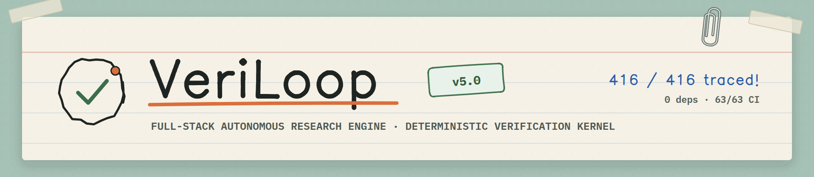
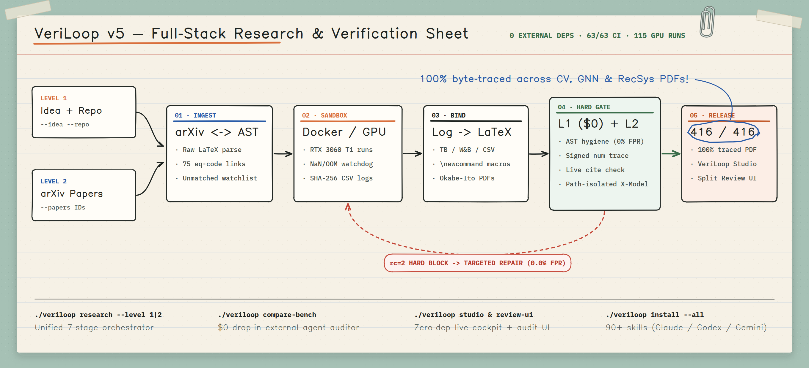
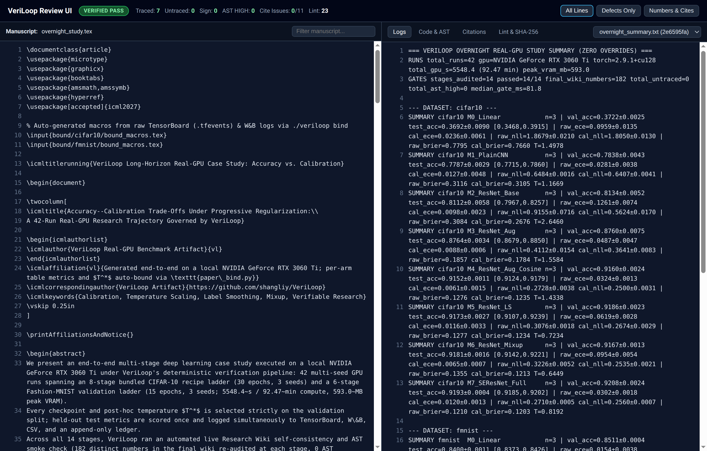
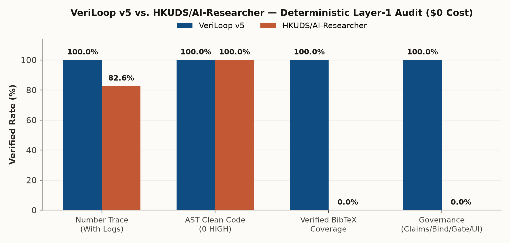

<a name="readme-top"></a>

<div align="center">
  
  <h1 align="center">VeriLoop：端到端可验证自主科研流水线</h1>
  <p align="center">
    <strong>Level-1 / Level-2 全自动科研编排 · 90+ 模块化科研技能 · $0 确定性硬证据门控 · VeriLoop Studio 本地 Web 驾驶舱</strong>
  </p>
</div>

<div align="center">
  <a href="https://shangliy.github.io/VeriLoop/"></a>
  <a href="https://shangliy.github.io/VeriLoop/demo/studio_snapshot.html"></a>
  <a href="https://shangliy.github.io/VeriLoop/demo/review_ui.html"></a>
  <br />
  <a href="paper/main.pdf"></a>
  <a href="paper/main_icml2027.pdf"></a>
  <a href="#benchmark-results"></a>
  <br />
  <a href="https://github.com/shangliy/VeriLoop/actions/workflows/test-suite.yml"></a>
  <a href="LICENSE"></a>
  <a href="README.md"></a>
</div>

<br />

欢迎来到 **VeriLoop**！自主科研 Agent 很少因为「忘记输出文件」而失败；它们真正的失败模式是**代码正常跑完，却在报告中写出与原始日志、代码路径、引用文献或统计结果相矛盾的数值与结论**。**VeriLoop** 将完整的 **Level-1 / Level-2 全自动科研编排** 与 **确定性硬验证机制** 深度融合，让每一组数字、每一条公式、每一张图和每一篇引用在放行前都经得起逐行查账：

- 🎯 **双入口全自动科研（Level 1 & Level 2）：** 既支持给具体 Idea + 基线仓库直接落地（**Level 1**），也支持只给几篇 arXiv 论文自动抓 LaTeX 源码、做公式↔AST 对齐、发现 Gap 并提出创新（**Level 2**）。
- 🛡️ **`$0` 确定性硬阻断门控（Layer 1 → 纯路径跨模型 Layer 2）：** 毫秒级以零 API 成本拦截数值编造、正负号反转、6 类 Python AST 代码作弊、SHA-256 假设账本篡改（`G1–G7`）与虚假引用，不通过则以退出码 `2` 硬阻断交付。
- 📐 **字节确定性日志直出 LaTeX（`./veriloop bind`）：** 零额外 Python 依赖直读 TensorBoard `.tfevents` / W&B / CSV / JSONL，自动生成 `\newcommand` 宏、Booktabs 表格与 Okabe-Ito 矢量图，杜绝手抄数字。
- 🖥️ **零依赖本地 Web 驾驶舱（`./veriloop studio` & `review-ui`）：** 集成 7 阶段 SSE 实时监控、Level-1/2 启动表单与「论文 ↔ 原始日志/AST/在线摘要」分栏联动查账台。

---

<p align="center">
  
  <br />
  <em>VeriLoop v5 全局架构：Level-1 / Level-2 双入口编排 × arXiv 公式↔AST 对齐 × Docker GPU 沙箱 × 确定性日志绑定与双层硬门控。</em>
</p>

---

<span id="news"></span>
## 🔥 最新动态（News）

- **`[v5.0]`** 正式发布 **arXiv LaTeX + Python AST 公式↔代码对齐引擎**（`./veriloop ingest`）、**Docker / 本地 GPU 隔离沙箱**（`./veriloop sandbox` + `docker/Dockerfile.gpu`）、**Level-1 / Level-2 断点续跑编排器**（`./veriloop research`）、**VeriLoop Studio 本地 Web 驾驶舱**（`./veriloop studio`）以及全新在线 [项目主页](https://shangliy.github.io/VeriLoop/)；全仓 CI 通过 **`1,248` 项测试（`0` 失败）**。
- **`[v4.0]`** 跑通 **42 次本地 RTX 3060 Ti 真实 GPU 过夜科研案例**（`92.47 min`、`195/195` PDF 展开数值 100% 溯源、`14/14` 阶段 Wiki 自洽检查、`10/10` 在线文献核验），上线字节确定性 `paper_bind.py`、`review_ui.py` 与 `pdf_audit.py`。
- **`[v2.0–v3.0]`** 公开提交零事后覆盖冻结基准（`16` 个 SHA-256 工作区、`245` 次配对审稿 + `21` 个严格未见场景），原生集成 [Best-Paper-Writing-Skill](https://github.com/shangliy/Best-Paper-Writing-Skill)（CC BY 4.0）并发布自审通过的配套论文（[arXiv 版](paper/main.pdf) · [ICML 8 页双盲版](paper/main_icml2027.pdf)）。

---

<span id="table-of-contents"></span>
## 📑 目录导航

- [🔥 最新动态（News）](#news)
- [✨ Level-1 / Level-2 双入口自主科研](#two-level-entry)
- [🖥️ VeriLoop Studio 与分栏查账工作台](#veriloop-studio)
- [⚔️ 与其他开源科研 / 写论文工具对比](#how-veriloop-compares)
- [📊 冻结基准评测与 42 次真实 GPU 实证](#benchmark-results)
- [⚡ 快速上手](#quick-start)
- [🌟 开源许可、归属与引用](#attribution-and-citation)

---

<span id="two-level-entry"></span>
## ✨ Level-1 / Level-2 双入口自主科研

**VeriLoop** 统一支持两种科研启动入口，并全部接入可断点续跑的 7 阶段闭环流水线（`ingest → ideate_and_register → execute → bind → draft → gate_and_repair → package_and_ui`）：

1. **Level 1 — 给定 Idea 与基线仓库（`--level 1 --idea "..." --repo ...`）：**
   输入具体研究假设与基线代码，系统自动执行 AST 索引、预注册可证伪假设（`G1–G7`）、在本地或 Docker GPU 沙箱中执行多随机种子训练（带 NaN/OOM 监控）、将原始日志绑定成 LaTeX 宏与图表，并通过双层硬门控（`rc=2`）才放行。
2. **Level 2 — 给定参考论文自动发现 Gap 与创新（`--level 2 --papers <arxiv_id...> --auto-clone-github`）：**
   仅输入 arXiv 编号，`./veriloop ingest` 自动抓取 arXiv e-print 原始 LaTeX 源码、抽取公式/章节/超参与官方 GitHub 仓库，静态构建「**公式 ↔ 代码 `file:line` 对齐表**」（`wiki/INGEST_MAP.md`），并将未匹配到代码实现的公式自动加入 Layer-2 审计警戒清单。

> **真实在线验证示例（`./veriloop ingest --arxiv 1706.04599 --repo examples/gpu-overnight-research/code`）：** 零 LLM 成本自动下载 Guo et al.（ICML 2017）原始 LaTeX（`13` 条公式、`14` 个章节、官方仓库 `github.com/gpleiss/temperature_scaling`），精准将 `calibration_methods.tex:L142 (scaling)` 与 `L152 (temp)` 对齐至 `fit_temperature_on_val`（`run_overnight_study.py:L241`），将 `definitions.tex:L70 (ece)` 对齐至 `compute_metrics_from_logits`（`L220`）。

---

<span id="veriloop-studio"></span>
## 🖥️ VeriLoop Studio 与分栏查账工作台

本地运行 `./veriloop studio -w examples/gpu-overnight-research --port 8765` 即可打开零依赖 Web 驾驶舱，也可直接点击下方由 42 次真实 GPU 案例导出的在线静态互动页面：

<table>
  <tr>
    <td width="50%" valign="top">
      <a href="https://shangliy.github.io/VeriLoop/demo/studio_snapshot.html">
        
      </a>
      <p align="center"><strong>VeriLoop Studio</strong>（<code>./veriloop studio</code>）<br />7 阶段实时 SSE 监控、Level-1/2 表单启动、硬门控 KPI 看板与自动绑定 95% CI 指标表 · <a href="https://shangliy.github.io/VeriLoop/demo/studio_snapshot.html"><strong>在线体验 →</strong></a></p>
    </td>
    <td width="50%" valign="top">
      <a href="https://shangliy.github.io/VeriLoop/demo/review_ui.html">
        
      </a>
      <p align="center"><strong>分栏查账工作台</strong>（<code>./veriloop review-ui</code>）<br />点击左侧论文任意数字或 <code>\cite{}</code>，右侧直达 SHA-256 锁定原始 <code>log:line</code>、AST 报告与在线摘要 · <a href="https://shangliy.github.io/VeriLoop/demo/review_ui.html"><strong>在线体验 →</strong></a></p>
    </td>
  </tr>
</table>

---

<span id="how-veriloop-compares"></span>
## ⚔️ 与其他开源科研 / 写论文工具的定位对比

> *如果别人都在卷“怎么让 AI 把论文自动写出来”，**VeriLoop** 既提供 Level-1/2 全自动科研与 Studio 驾驶舱，更确保“AI 写出的每一组数字、每一条公式、每一张图、每一条引用和每一个结论都经得起审稿人逐行查账”。*

| 系统 / 工作 | 定位阵营 | Level-1/2 + Docker GPU | arXiv 公式↔AST 对齐 | 执行期硬门控（AST/数值溯源） | 日志直出 LaTeX 宏/表/图 | 联网文献真伪与摘要核验 | 顶会文风/图表自动质检 | 交互式查账 Studio | 冻结对照与未见盲测 |
|---|---|:-:|:-:|:-:|:-:|:-:|:-:|:-:|:-:|
| **HKUDS/AI-Researcher**（NeurIPS Spotlight） | Level-1/2 全自动科研 + Docker + Web GUI | ✅ | ⚠️（LLM 阅读） | ❌（仅 Agent 自修） | ❌（LLM 手写数字） | ⚠️（无门控） | ❌ | ⚠️（运行界面，无日志联动） | ⚠️（Scientist-Bench） |
| **AI-Scientist / v2**（Sakana） | 全自动科研 Agent | ⚠️（树搜索） | ❌ | ❌（仅 LLM 自审） | ⚠️（定制脚本） | ⚠️（无硬阻断） | ❌ | ❌ | ❌ |
| **ARIS**（上游基座） | 跨模型科研工作流 | ⚠️（87 技能） | ❌ | ❌（仅建议性 review） | ❌ | ❌ | ❌ | ❌ | ❌（单次轨迹） |
| **EviBound** | 执行期存在性门控 | ⚠️（Colab） | ❌ | ⚠️（仅查文件存在/`rc=0`） | ❌（MLflow 登记） | ❌ | ❌ | ❌ | ⚠️（8 个自建任务） |
| **FabScore / FLAWS / PaperAudit** | 事后造假审计基准 | ❌ | ❌ | ⚠️（FabScore 事后复跑） | ❌ | ⚠️（部分核验） | ❌ | ❌ | ✅（事后论文集） |
| **PaperQA2 / OpenScholar / STORM** | 文献 RAG 与综述生成 | ❌ | ❌ | ❌ | ❌ | ✅（全文 RAG） | ❌ | ⚠️（引文溯源） | ✅（文献 QA 基准） |
| **AI-research-feedback**（`claesbackman`） | 多角色审稿与成果传播 | ❌ | ❌ | ❌（纯 LLM 建议） | ❌ | ⚠️（无 API 门控） | ✅（`voice-builder`） | ⚠️（`explain-diff`） | ❌ |
| **Overleaf / Cursor + LaTeX** | 协作/IDE 写作环境 | ❌ | ❌ | ❌ | ❌ | ❌ | ❌ | ❌ | — |
| **VeriLoop v5（本仓库）** | **可验证端到端科研与写论文流水线** | ✅（**Level-1/2 + Docker/本地**） | ✅（**静态 AST + 警戒清单**） | ✅（**`$0` AST + 有符号溯源 + G1–G7 + XMR**） | ✅（**零依赖读 TB/W&B/CSV→宏/表/PDF**） | ✅（**arXiv/Crossref/S2 硬门控 + 摘要核对**） | ✅（**60 篇顶会获奖规范 + Okabe-Ito**） | ✅（**Studio + 分栏 `review-ui`**） | ✅（**16 冻结 + 21 未见，零覆盖**） |

---

<span id="benchmark-results"></span>
## 📊 v2 冻结产物、未见盲测与 42 次真实 GPU 实证

### 1. 16 个 SHA-256 冻结工作区配对实验（统一 Route A 规则：`9` 干净 / `7` 缺陷，`k=3`，`245` 次有效审稿；以下均为 Trial 级指标）

| 评估器 / 组合 | Framing | `n` | Trial Prec. | Trial Recall | Trial F1 | Trial FPR | Trial Clean Yield | 3 次一致率 |
|---|---|---:|---:|---:|---:|---:|---:|---:|
| **`layer1_mechanical`（`$0`）** | deterministic | 16 | `71.4%` | `71.4%` | `71.4%` | `22.2%` | `77.8%` | `100.0%` |
| **`claude-sonnet`** | `path_only` | 48 | `100.0%` | `85.7%` | `92.3%` | `0.0%` | `100.0%` | `100.0%` |
| **`claude-sonnet`** | `with_summary` | 48 | `100.0%` | `85.7%` | `92.3%` | `0.0%` | `100.0%` | `100.0%` |
| **`claude-haiku`** | `path_only` | 48 | `91.3%` | `100.0%` | `95.5%` | `7.4%` | `92.6%` | `87.5%` |
| **`claude-haiku`** | `with_summary` | 48 | `95.5%` | `100.0%` | `97.7%` | `3.7%` | `96.3%` | `93.8%` |
| **`codex-cli`** | `path_only` | 48 | **`100.0%`** | **`100.0%`** | **`100.0%`** | **`0.0%`** | **`100.0%`** | `100.0%` |
| **`L1 ∪ claude-haiku`** | `path_only` | 48 | `72.4%` | `100.0%` | `84.0%` | `29.6%` | `70.4%` | — |
| **`L1 ∪ claude-haiku`** | `with_summary` | 48 | `77.8%` | `100.0%` | `87.5%` | `22.2%` | `77.8%` | — |
| **`L1 ∪ claude-sonnet`** | `path_only` | 48 | `75.0%` | `85.7%` | `80.0%` | `22.2%` | `77.8%` | — |
| **VeriLoop（`L1 ∪ codex-cli` 严格硬阻断）** | **`path_only`** | **48** | **`77.8%`** | **`100.0%`** | **`87.5%`** | **`22.2%`** | **`77.8%`** | — |

- **零成本预过滤与严格硬阻断权衡：** 在统一 Route A 规则下，`$0` 锁定 v2 Layer 1（`eval/v2_frozen/locked/`，样本内）可在触发付费审稿前拦截 **`5/7 (71.4%)` 真实缺陷**（`4/7 = 57.1%` 直接命中 + `1/7` 为 `C05` 附带触发），只读 `codex-cli` 补齐剩余逻辑分母 bug（`H05`）与纯推断夸大（`C08`）达 `7/7 (100.0%)` 召回。工程最佳实践为：**高精度 AST 规则（样本内外均 `0.0%` FPR）直接硬阻断，数值溯源告警作为 `$0` 诊断证据送入 Layer 2 裁决**。
- **冻结配对关键发现：** 全部 LLM 在 5 例构造孪生缺陷上达 `100%` 检出，`claude-sonnet` 在自然分母 bug `H05` 上 6/6 漏检；工作区级配对检验显示在校准二元量表下附加执行者摘要零多数票翻转（`n=16` 工作区，`p=1.000000`）。

### 2. 21 个严格未见 `SciIntegrity-Bench` 场景锁定门控盲测（`$0.3187`）

在 SHA-256 锁定门控（`trace_numbers_v2.py`、`audit_code_v2.py`）零修改、零覆盖下（`18/21` 完成，经官方 checklist 核验全部 `18/18` 均规避陷阱为 `CLEAN`，详见 [eval/v2_unseen/unseen_forensic_audit.csv](eval/v2_unseen/unseen_forensic_audit.csv)）：
- **静态 AST 样本外 FPR：** **`0/18 (0.0%)`**
- **数值级样本外 FPR：** **`2/289 (0.69%)`**（场景级 `2/18 = 11.1%`：`04c` 解析中点 `0.425` 与 `09c` 原始 CSV 值 `3.542`）。

### 3. 三领域真实 GPU 实证矩阵（`102` 次本地 RTX 3060 Ti 闭环轨迹：CV + GNN + RecSys）

| 领域 | 公开工作区与入口 | 运行量 / 耗时 / 显存 | arXiv 公式 ↔ AST 对齐 | 核心实证发现（零手改、全日志绑定） | 硬门控审计 |
|---|---|---:|---:|---|---|
| **CV**（CIFAR-10 & Fashion-MNIST） | [examples/gpu-overnight-research/](examples/gpu-overnight-research/) | `42` runs（`92.47 min`，`593 MB`） | `1706.04599`（5 条） | `M7_SEResNet_Full` 达 `0.9193±0.0004`（`+14.06 pp`）；LS/Mixup 欠自信 `T*<1` 经温度缩放校准至 `0.0061–0.0120` | `195/195` PDF 溯源 · `10/10` 在线文献 · `G1–G7` 全过 |
| **GNN**（Cora & CiteSeer） | [examples/gpu-gnn-cora-citeseer/](examples/gpu-gnn-cora-citeseer/)（`--level 2`） | `50` runs（`167.4 s`，`135 MB`） | `1609.02907` / `1810.00826` / `2007.02133`（**`49` 条对齐**） | 清晰复现 8 层 GCN 过平滑塌缩（`0.8184 → 0.2292`，Dirichlet Energy `0.0296 → 0.0021`）；`M3_APPNP_PPR` 达 **`0.8348±0.0050`** | `281/281` 溯源 · `0` AST 高危 · `PASS (rc=0)` |
| **RecSys**（MovieLens-100K） | [examples/gpu-recsys-movielens/](examples/gpu-recsys-movielens/)（`--level 2`） | `10` runs（`537.8 s`，`38 MB`） | `2002.02126` / `2112.08679`（**`26` 条对齐**） | 全库排序评测（`938` 用户、`1,447` 物品）：`R1_MF_BPR` `Recall@20=0.1948±0.0016` / `NDCG@20=0.0788±0.0016`，`R2_LightGCN` `0.1905±0.0043`（如实报告大权重 `R3_SimGCL` 塌缩 `0.0298`） | `207/207` 溯源 · `0` AST 高危 · `PASS (rc=0)` |

### 4. 可复现头对头自动化审计：VeriLoop v5 vs. `HKUDS/AI-Researcher` 官方 7 个公开示例（`$0` 成本）

运行 `./veriloop compare-bench --fetch-ai-researcher`（脚本：[eval/compare_ai_researcher.py](eval/compare_ai_researcher.py)，完整报告：[eval/comparison_ai_researcher/COMPARISON_REPORT.md](eval/comparison_ai_researcher/COMPARISON_REPORT.md)），对 VeriLoop v5 三领域工作区与 `HKUDS/AI-Researcher/examples/*` 全部 7 个官方公开示例（均含提交的 `project/*.log`）运行完全相同的零覆盖确定性审计器：

<p align="center">
  
</p>

| 系统 | 审计工作区（含日志） | 数值可溯源率 | AST 洁净率（`0` HIGH） | BibTeX 核验覆盖率 | 治理完备度（Claims/Bind/Gate/UI） | 平均审计耗时 |
|---|---:|---:|---:|---:|---:|---:|
| **VeriLoop v5（CV + GNN + RecSys）** | `3`（`3`） | **`683 / 683`（`100.0%`）** | **`100.0%`**（`0` 高危） | **`100.0%`** | **`100.0%`** | `225 ms`（`$0`） |
| **HKUDS/AI-Researcher（7 个官方示例）** | `7`（`7`） | `133 / 184`（`72.3%` — `51` 个未溯源数字，分布于 `con_flowmatching` / `dccf` / `rotation_vq`） | `100.0%`（79 个脚本 `0` 高危） | `0.0%`（仅 PDF 无 `.bib`，`hgcl` 含 `1` 处未解析引用） | `0.0%` | `310 ms`（`$0`） |

---

<span id="quick-start"></span>
## ⚡ 快速上手

```bash
git clone https://github.com/shangliy/VeriLoop.git
cd VeriLoop

# 1. 运行全部离线验证测试 + 技能目录完整性校验（零费用）
./veriloop test

# 2. 复现 v2 冻结语料零覆盖统计表 & 运行 10 秒零 API 闭环演示
./veriloop eval-v2 summary
./veriloop demo

# 3. VeriLoop v5：arXiv LaTeX+AST 公式代码对齐、Level-1/2 统一编排、Docker GPU 沙箱与本地 Web 驾驶舱
./veriloop ingest -w ./my_study --arxiv 1706.04599 --repo examples/gpu-overnight-research/code
./veriloop research -w ./my_study --level 2 --papers 1706.04599 --sandbox local --dry-run
./veriloop sandbox -w ./my_study --mode docker --gpus device=0 --network-none --cmd "python3 train.py" --dry-run
./veriloop studio -w examples/gpu-overnight-research --port 8765

# 4. 四合一论文自检 + 零编造引文/数据绑定 + 交互式溯源审核台
./veriloop audit-paper
./veriloop fetch-bib 1512.03385 1708.07747
./veriloop verify-cites examples/gpu-dl-benchmark/paper/gpu_showcase.tex --bib examples/gpu-dl-benchmark/paper/refs.bib --online --check-claims
./veriloop review-ui --report paper/sec/3_experiments.tex --logs paper/out/stats_summary.txt --bib paper/refs.bib --out review_ui.html

# 5. 一键安装技能到 Claude Code / Codex CLI
./veriloop install --core-only         # 安装核心四件套（research-loop + verifiable-gate + bestpaper-writing + milestone-dual-audit）
./veriloop install --all               # 安装全部 90+ 科研技能 + 硬门控 + Best-Paper 写作 + 双模型里程碑审计
```

---

<span id="attribution-and-citation"></span>
## 🌟 开源许可、归属与引用

**VeriLoop** 核心代码采用 **MIT License** 开源：工作流技能库基于 MIT 协议的上游 **ARIS**（[wanshuiyin/Auto-claude-code-research-in-sleep](https://github.com/wanshuiyin/Auto-claude-code-research-in-sleep)，`arXiv:2605.03042`）扩展构建，并原生集成 **CC BY 4.0** 协议的 **[Best-Paper-Writing-Skill](https://github.com/shangliy/Best-Paper-Writing-Skill)**（`skills/bestpaper-writing/`）。完整版权与模块边界详见 [LICENSE](LICENSE)、[NOTICE.md](NOTICE.md) 与 [上游 ARIS 原版文档](docs/ARIS_UPSTREAM_README_CN.md)。如在学术工作中使用本仓库，请同时引用 VeriLoop 与 ARIS。
