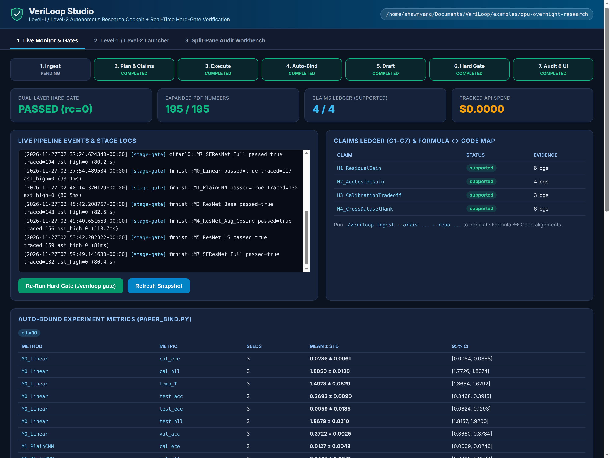

<a name="readme-top"></a>

<div align="center">
  
  <h1 align="center">VeriLoop：全栈自主科研引擎与确定性验证内核</h1>
  <p align="center">
    <strong>6 大零依赖核心引擎 · Level-1 / Level-2 全栈科研 OS · 90+ 技能 · 115 次 RTX 3060 Ti 实跑 · 外部 Agent 法医级审计</strong>
  </p>
</div>

<div align="center">
  <a href="https://shangliy.github.io/VeriLoop/"></a>
  <a href="https://shangliy.github.io/VeriLoop/demo/studio_snapshot.html"></a>
  <a href="https://shangliy.github.io/VeriLoop/demo/review_ui.html"></a>
  <br />
  <a href="paper/main.pdf"></a>
  <a href="paper/main_icml2027.pdf"></a>
  <a href="#benchmark-results"></a>
  <br />
  <a href="https://github.com/shangliy/VeriLoop/actions/workflows/test-suite.yml"></a>
  <a href="LICENSE"></a>
  <a href="README.md"></a>
</div>

<br />

**VeriLoop** 是一套面向实战的、零外部依赖的**全栈自主科研基础设施**——既能端到端跑通论文解析、GPU 沙箱训练与顶会稿件生成，又能把论文中的每一组数字、代码路径与引用文献精确校验到磁盘字节。核心引擎 100% 基于 Python 3.10+ 标准库（`0` 第三方依赖冲突，Ubuntu + macOS `63/63` CI 绿灯），原生兼容 **Claude Code / Codex CLI / Gemini CLI / OpenCode 与任意 LLM 后端**：

- **全栈自主科研 OS（`ingest` → `sandbox` → `research` → `bind` → `gate` → `studio`）：** 统一支持 **Level 1（Idea + 基线仓库）** 与 **Level 2（arXiv 论文 → 公式↔AST 静态对齐 → Gap → 创新）** 双入口，内置 `90+` 模块化科研生命周期技能与 `state.json` 断点续跑调度。
- **单卡消费级 GPU 三领域实跑验证（`115` 次 RTX 3060 Ti 闭环）：** 完整跑通并编译独立 ICML PDF 涵盖 **CV（42 次）**、**GNN（60 次，自动诊断并修复 8 层 GCNII 塌缩 `+54 pp`）** 与 **RecSys（13 次，自动诊断并修复 SimGCL 过正则塌缩超越全部基线）**，全部 **`416/416（100.0%）`** PDF 展开数值精确溯源。
- **`$0` 确定性验证核 + 字节级日志直出 LaTeX：** 标准库直读 TensorBoard / W&B / CSV / JSONL 自动生成 `\newcommand` 宏、Booktabs 三线表与 Okabe-Ito 矢量图；执行静态 AST 门控（`0.0%` FPR）、SHA-256 假设账本（`G1–G7`）与在线文献核验，缺陷即以 `rc=2` 硬阻断。
- **可独立审计外部科研 Agent（`./veriloop compare-bench`）+ 零依赖本地驾驶舱：** 一行命令以 `$0` 成本审计任意外部 Agent 的仓库与 PDF（对 `HKUDS/AI-Researcher` 7 篇官方 PDF 检出 `25` 处无日志/超日志表格数值），并提供 **VeriLoop Studio** 与分栏查账台 `review-ui`。

> **仓库工程定位 vs. 配套论文贡献边界：** 本仓库交付完整的 **v5 全栈科研平台**（编排器、Docker GPU 沙箱、Studio 驾驶舱、90+ 技能与外部审计器）；配套论文（[ICML 8 页双盲版](paper/main_icml2027.pdf) · [arXiv 预印本](paper/main.pdf)）则克制聚焦于**四项可证伪的核心学术贡献**：*(1)* 将随机探索与零依赖确定性验证核及路径隔离跨模型审稿解耦；*(2)* 公开 `16` 个 SHA-256 冻结工作区（`245` 次配对审稿）量化严阻断与级联诊断的召回-良率权衡；*(3)* 在 `21` 个严格未见 `SciIntegrity-Bench` 场景上给出样本外机械 FPR 诚实标定（`0.0%` AST FPR、`0.69%` 数值级 FPR）；*(4)* 外部 7 篇官方论文法医级审计与全自审配套论文发布。

---

<p align="center">
  
  <br />
  <em>VeriLoop v5 全栈闭环架构 — Level-1/2 双入口、arXiv↔AST 对齐、GPU 隔离沙箱、零手抄日志绑定、双层硬门控与 <code>rc=2</code> 修复回流、Studio / Review UI 交付。</em>
</p>

---

<span id="news"></span>
## 最新动态（News）

- **`[v5.0]`** 正式发布全栈 v5 引擎（`ingest`、`sandbox` + `docker/Dockerfile.gpu`、`research` Level-1/2 编排器、`studio` SSE 驾驶舱与 `compare-bench` 外部审计器）；在本地 RTX 3060 Ti 扩展至 **CV + GNN + RecSys 三领域 `115` 次实跑（3 篇独立 ICML PDF，`416/416` 溯源）**，完成对 7 篇 `HKUDS/AI-Researcher` 官方示例的头对头法医审计（`25` 处无日志指标，`0/79` AST 误报），并上线全新视觉改版的 [项目主页](https://shangliy.github.io/VeriLoop/)。Ubuntu + macOS 跨平台 CI 通过 **`63/63` 核心套件（`0` 失败）**。
- **`[v4.0]`** 跑通 **42 次本地 RTX 3060 Ti 真实 GPU 过夜 CV 科研案例**（`92.47 min`、`195/195` PDF 展开数值 100% 溯源、`14/14` 阶段 Wiki 自洽检查、`10/10` 在线文献核验），上线字节确定性 `paper_bind.py`、`review_ui.py` 与 `pdf_audit.py`。
- **`[v2.0–v3.0]`** 公开提交零事后覆盖冻结基准（`16` 个 SHA-256 工作区、`245` 次配对审稿 + `21` 个严格未见场景），原生集成 [Best-Paper-Writing-Skill](https://github.com/shangliy/Best-Paper-Writing-Skill)（CC BY 4.0）并发布自审通过的配套论文（[arXiv 版](paper/main.pdf) · [ICML 8 页双盲版](paper/main_icml2027.pdf)）。

---

<span id="table-of-contents"></span>
## 目录导航

- [最新动态（News）](#news)
- [Level-1 / Level-2 双入口自主科研](#two-level-entry)
- [VeriLoop Studio 与分栏查账工作台](#veriloop-studio)
- [与其他开源科研 / 写论文工具对比](#how-veriloop-compares)
- [冻结基准、115 次三领域 GPU 实证与外部审计](#benchmark-results)
- [快速上手](#quick-start)
- [开源许可、归属与引用](#attribution-and-citation)

---

<span id="two-level-entry"></span>
## ✨ Level-1 / Level-2 双入口自主科研

**VeriLoop** 统一支持两种科研启动入口，并全部接入可断点续跑的 7 阶段闭环流水线（`ingest → ideate_and_register → execute → bind → draft → gate_and_repair → package_and_ui`）：

1. **Level 1 — 给定 Idea 与基线仓库（`--level 1 --idea "..." --repo ...`）：**
   输入具体研究假设与基线代码，系统自动执行 AST 索引、预注册可证伪假设（`G1–G7`）、在本地或 Docker GPU 沙箱中执行多随机种子训练（带 NaN/OOM 监控）、将原始日志绑定成 LaTeX 宏与图表，并通过双层硬门控（`rc=2`）才放行。
2. **Level 2 — 给定参考论文自动发现 Gap 与创新（`--level 2 --papers <arxiv_id...> --auto-clone-github`）：**
   仅输入 arXiv 编号，`./veriloop ingest` 自动抓取 arXiv e-print 原始 LaTeX 源码、抽取公式/章节/超参与官方 GitHub 仓库，静态构建「**公式 ↔ 代码 `file:line` 对齐表**」（`wiki/INGEST_MAP.md`），并将未匹配到代码实现的公式自动加入 Layer-2 审计警戒清单。

> **真实在线验证示例（`./veriloop ingest --arxiv 1706.04599 --repo examples/gpu-overnight-research/code`）：** 零 LLM 成本自动下载 Guo et al.（ICML 2017）原始 LaTeX（`13` 条公式、`14` 个章节、官方仓库 `github.com/gpleiss/temperature_scaling`），精准将 `calibration_methods.tex:L142 (scaling)` 与 `L152 (temp)` 对齐至 `fit_temperature_on_val`（`run_overnight_study.py:L241`），将 `definitions.tex:L70 (ece)` 对齐至 `compute_metrics_from_logits`（`L220`）。

---

<span id="veriloop-studio"></span>
## 🖥️ VeriLoop Studio 与分栏查账工作台

本地运行 `./veriloop studio -w examples/gpu-overnight-research --port 8765` 即可打开零依赖 Web 驾驶舱，也可直接点击下方由 42 次真实 GPU 案例导出的在线静态互动页面：

<table>
  <tr>
    <td width="50%" valign="top">
      <a href="https://shangliy.github.io/VeriLoop/demo/studio_snapshot.html">
        
      </a>
      <p align="center"><strong>VeriLoop Studio</strong>（<code>./veriloop studio</code>）<br />7 阶段实时 SSE 监控、Level-1/2 表单启动、硬门控 KPI 看板与自动绑定 95% CI 指标表 · <a href="https://shangliy.github.io/VeriLoop/demo/studio_snapshot.html"><strong>在线体验 →</strong></a></p>
    </td>
    <td width="50%" valign="top">
      <a href="https://shangliy.github.io/VeriLoop/demo/review_ui.html">
        
      </a>
      <p align="center"><strong>分栏查账工作台</strong>（<code>./veriloop review-ui</code>）<br />点击左侧论文任意数字或 <code>\cite{}</code>，右侧直达 SHA-256 锁定原始 <code>log:line</code>、AST 报告与在线摘要 · <a href="https://shangliy.github.io/VeriLoop/demo/review_ui.html"><strong>在线体验 →</strong></a></p>
    </td>
  </tr>
</table>

---

<span id="how-veriloop-compares"></span>
## ⚔️ 与其他开源科研 / 写论文工具的定位对比

> *如果别人都在卷“怎么让 AI 把论文自动写出来”，**VeriLoop** 既提供 Level-1/2 全自动科研与 Studio 驾驶舱，更确保“AI 写出的每一组数字、每一条公式、每一张图、每一条引用和每一个结论都经得起审稿人逐行查账”。*

| 系统 / 工作 | 定位阵营 | Level-1/2 + Docker GPU | arXiv 公式↔AST 对齐 | 执行期硬门控（AST/数值溯源） | 日志直出 LaTeX 宏/表/图 | 联网文献真伪与摘要核验 | 顶会文风/图表自动质检 | 交互式查账 Studio | 冻结对照与未见盲测 |
|---|---|:-:|:-:|:-:|:-:|:-:|:-:|:-:|:-:|
| **HKUDS/AI-Researcher**（NeurIPS Spotlight） | Level-1/2 全自动科研 + Docker + Web GUI | ✅ | ⚠️（LLM 阅读） | ❌（仅 Agent 自修） | ❌（LLM 手写数字） | ⚠️（无门控） | ❌ | ⚠️（运行界面，无日志联动） | ⚠️（Scientist-Bench） |
| **AI-Scientist / v2**（Sakana） | 全自动科研 Agent | ⚠️（树搜索） | ❌ | ❌（仅 LLM 自审） | ⚠️（定制脚本） | ⚠️（无硬阻断） | ❌ | ❌ | ❌ |
| **ARIS**（上游基座） | 跨模型科研工作流 | ⚠️（87 技能） | ❌ | ❌（仅建议性 review） | ❌ | ❌ | ❌ | ❌ | ❌（单次轨迹） |
| **EviBound** | 执行期存在性门控 | ⚠️（Colab） | ❌ | ⚠️（仅查文件存在/`rc=0`） | ❌（MLflow 登记） | ❌ | ❌ | ❌ | ⚠️（8 个自建任务） |
| **FabScore / FLAWS / PaperAudit** | 事后造假审计基准 | ❌ | ❌ | ⚠️（FabScore 事后复跑） | ❌ | ⚠️（部分核验） | ❌ | ❌ | ✅（事后论文集） |
| **PaperQA2 / OpenScholar / STORM** | 文献 RAG 与综述生成 | ❌ | ❌ | ❌ | ❌ | ✅（全文 RAG） | ❌ | ⚠️（引文溯源） | ✅（文献 QA 基准） |
| **AI-research-feedback**（`claesbackman`） | 多角色审稿与成果传播 | ❌ | ❌ | ❌（纯 LLM 建议） | ❌ | ⚠️（无 API 门控） | ✅（`voice-builder`） | ⚠️（`explain-diff`） | ❌ |
| **Overleaf / Cursor + LaTeX** | 协作/IDE 写作环境 | ❌ | ❌ | ❌ | ❌ | ❌ | ❌ | ❌ | — |
| **VeriLoop v5（本仓库）** | **可验证端到端科研与写论文流水线** | ✅（**Level-1/2 + Docker/本地**） | ✅（**静态 AST + 警戒清单**） | ✅（**`$0` AST + 有符号溯源 + G1–G7 + XMR**） | ✅（**零依赖读 TB/W&B/CSV→宏/表/PDF**） | ✅（**arXiv/Crossref/S2 硬门控 + 摘要核对**） | ✅（**60 篇顶会获奖规范 + Okabe-Ito**） | ✅（**Studio + 分栏 `review-ui`**） | ✅（**16 冻结 + 21 未见，零覆盖**） |

---

<span id="benchmark-results"></span>
## 冻结基准、115 次三领域 GPU 实证与外部审计

### 1. 16 个 SHA-256 冻结工作区配对实验（统一 Route A 规则：`9` 干净 / `7` 缺陷，`k=3`，`245` 次有效审稿；以下均为 Trial 级指标）

| 评估器 / 组合 | Framing | `n` | Trial Prec. | Trial Recall | Trial F1 | Trial FPR | Trial Clean Yield | 3 次一致率 |
|---|---|---:|---:|---:|---:|---:|---:|---:|
| **`layer1_mechanical`（`$0`）** | deterministic | 16 | `71.4%` | `71.4%` | `71.4%` | `22.2%` | `77.8%` | `100.0%` |
| **`claude-sonnet`** | `path_only` | 48 | `100.0%` | `85.7%` | `92.3%` | `0.0%` | `100.0%` | `100.0%` |
| **`claude-sonnet`** | `with_summary` | 48 | `100.0%` | `85.7%` | `92.3%` | `0.0%` | `100.0%` | `100.0%` |
| **`claude-haiku`** | `path_only` | 48 | `91.3%` | `100.0%` | `95.5%` | `7.4%` | `92.6%` | `87.5%` |
| **`claude-haiku`** | `with_summary` | 48 | `95.5%` | `100.0%` | `97.7%` | `3.7%` | `96.3%` | `93.8%` |
| **`codex-cli`** | `path_only` | 48 | **`100.0%`** | **`100.0%`** | **`100.0%`** | **`0.0%`** | **`100.0%`** | `100.0%` |
| **`L1 ∪ claude-haiku`** | `path_only` | 48 | `72.4%` | `100.0%` | `84.0%` | `29.6%` | `70.4%` | — |
| **`L1 ∪ claude-haiku`** | `with_summary` | 48 | `77.8%` | `100.0%` | `87.5%` | `22.2%` | `77.8%` | — |
| **`L1 ∪ claude-sonnet`** | `path_only` | 48 | `75.0%` | `85.7%` | `80.0%` | `22.2%` | `77.8%` | — |
| **VeriLoop（`L1 ∪ codex-cli` 严格硬阻断）** | **`path_only`** | **48** | **`77.8%`** | **`100.0%`** | **`87.5%`** | **`22.2%`** | **`77.8%`** | — |

- **零成本预过滤与严格硬阻断权衡：** 在统一 Route A 规则下，`$0` 锁定 v2 Layer 1（`eval/v2_frozen/locked/`，样本内）可在触发付费审稿前拦截 **`5/7 (71.4%)` 真实缺陷**（`4/7 = 57.1%` 直接命中 + `1/7` 为 `C05` 附带触发），只读 `codex-cli` 补齐剩余逻辑分母 bug（`H05`）与纯推断夸大（`C08`）达 `7/7 (100.0%)` 召回。工程最佳实践为：**高精度 AST 规则（样本内外均 `0.0%` FPR）直接硬阻断，数值溯源告警作为 `$0` 诊断证据送入 Layer 2 裁决**。
- **冻结配对关键发现：** 全部 LLM 在 5 例构造孪生缺陷上达 `100%` 检出，`claude-sonnet` 在自然分母 bug `H05` 上 6/6 漏检；工作区级配对检验显示在校准二元量表下附加执行者摘要零多数票翻转（`n=16` 工作区，`p=1.000000`）。

### 2. 21 个严格未见 `SciIntegrity-Bench` 场景锁定门控盲测（`$0.3187`）

在 SHA-256 锁定门控（`trace_numbers_v2.py`、`audit_code_v2.py`）零修改、零覆盖下（`18/21` 完成，经官方 checklist 核验全部 `18/18` 均规避陷阱为 `CLEAN`，详见 [eval/v2_unseen/unseen_forensic_audit.csv](eval/v2_unseen/unseen_forensic_audit.csv)）：
- **静态 AST 样本外 FPR：** **`0/18 (0.0%)`**
- **数值级样本外 FPR：** **`2/289 (0.69%)`**（场景级 `2/18 = 11.1%`：`04c` 解析中点 `0.425` 与 `09c` 原始 CSV 值 `3.542`）。

### 3. 三领域真实 GPU 实证矩阵（`115` 次本地 RTX 3060 Ti 闭环：CV + GNN + RecSys，均编译独立 ICML PDF）

| 领域 | 公开工作区与编译 PDF | 运行量 / 耗时 / 显存 | arXiv 公式 ↔ AST 对齐 | 核心实证与迭代修复闭环（零手改、全日志绑定） | 展开 PDF 审计 |
|---|---|---:|---:|---|---|
| **CV**（CIFAR-10 & Fashion-MNIST） | [examples/gpu-overnight-research/](examples/gpu-overnight-research/) · [overnight_study.pdf](examples/gpu-overnight-research/paper/overnight_study.pdf) | `42` runs（`92.47 min`，`593 MB`） | `1706.04599`（5 条） | `M7_SEResNet_Full` 达 `0.9193±0.0004`（`+14.06 pp`）；LS/Mixup 欠自信 `T*<1` 校准至 `0.0061–0.0120` | **`195/195`（`100%`）** · `0` warn · `10/10` 在线文献 |
| **GNN**（Cora & CiteSeer） | [examples/gpu-gnn-cora-citeseer/](examples/gpu-gnn-cora-citeseer/) · [gnn_study.pdf](examples/gpu-gnn-cora-citeseer/paper/gnn_study.pdf)（`--level 2`） | `60` runs（`295.8 s`，`135 MB`） | `1609.02907` / `1810.00826` / `2007.02133`（**`49` 条对齐**） | 8 层 GCN 过平滑塌缩（`0.8184 → 0.2292`）；`M3_APPNP_PPR` 达 `0.8348±0.0050`；诊断 `M4_GCNII_8L` 统一衰减塌缩（`0.2868`）→ 分组衰减 **`M4b_GCNII_SplitWD` 拉回 `0.8266±0.0045`（Cora）/ `0.7108±0.0112`（CiteSeer）** | **`129/129`（`100%`）** · `0` warn · `0` AST 高危 |
| **RecSys**（MovieLens-100K） | [examples/gpu-recsys-movielens/](examples/gpu-recsys-movielens/) · [recsys_study.pdf](examples/gpu-recsys-movielens/paper/recsys_study.pdf)（`--level 2`） | `13` runs（`1645.2 s`，`38 MB`） | `2002.02126` / `2112.08679`（**`26` 条对齐**） | 全库排序（`938` 用户、`1,447` 物品）：诊断 `R3_SimGCL` 过重对比损失塌缩（`0.0298`）→ 调平衡后 **`R3b_SimGCL_Tuned` 全面反超所有基线达 `Recall@20=0.2061±0.0006` / `NDCG@20=0.0855±0.0002`** | **`92/92`（`100%`）** · `0` warn · `0` AST 高危 |

### 4. 可复现 PDF-to-PDF 头对头审计：VeriLoop v5 vs. `HKUDS/AI-Researcher` 官方 7 个公开示例（`$0` 成本）

运行 `./veriloop compare-bench --fetch-ai-researcher`（脚本：[compare_ai_researcher.py](eval/compare_ai_researcher.py)，汇总报告：[COMPARISON_REPORT.md](eval/comparison_ai_researcher/COMPARISON_REPORT.md)，逐行法医核验表：[ai_researcher_forensic_audit.csv](eval/comparison_ai_researcher/ai_researcher_forensic_audit.csv)），将 `project/` 下全部 `.log/.txt/.csv/.json` 均公平纳入检索：

<p align="center">
  
</p>

| 系统 | 编译 PDF（含日志） | 展开 PDF 数值溯源率 | 法医确认无日志/超日志指标 | AST 洁净率（`0` HIGH） | BibTeX 核验覆盖率 | 治理完备度（Claims/Bind/Gate/UI） | 平均审计耗时 |
|---|---:|---:|---:|---:|---:|---:|---:|
| **VeriLoop v5（CV + GNN + RecSys）** | `3`（`3`） | **`416 / 416`（`100.0%`）** | **`0`** | **`100.0%`**（`0` 高危） | **`100.0%`** | **`100.0%`** | `283 ms`（`$0`） |
| **HKUDS/AI-Researcher（7 个官方示例）** | `7`（`7`） | `152 / 184`（`82.6%`） | **`25`**（+`7` 元数据；如 `dccf` 声称 `Recall@40` 达 `0.1226`，但全部 12 份日志最高仅 `0.0693`；`con_flowmatching` 5 份 `.log` 全为 `0` 字节） | `100.0%`（79 个脚本 `0` 高危） | `0.0%`（仅 PDF 无 `.bib`，`hgcl` 含 `1` 处未解析引用） | `0.0%` | `348 ms`（`$0`） |

---

<span id="quick-start"></span>
## ⚡ 快速上手

```bash
git clone https://github.com/shangliy/VeriLoop.git
cd VeriLoop

# 1. 运行全部离线验证测试 + 技能目录完整性校验（零费用）
./veriloop test

# 2. 复现 v2 冻结语料零覆盖统计表 & 运行 10 秒零 API 闭环演示
./veriloop eval-v2 summary
./veriloop demo

# 3. VeriLoop v5：arXiv LaTeX+AST 公式代码对齐、Level-1/2 统一编排、Docker GPU 沙箱与本地 Web 驾驶舱
./veriloop ingest -w ./my_study --arxiv 1706.04599 --repo examples/gpu-overnight-research/code
./veriloop research -w ./my_study --level 2 --papers 1706.04599 --sandbox local --dry-run
./veriloop sandbox -w ./my_study --mode docker --gpus device=0 --network-none --cmd "python3 train.py" --dry-run
./veriloop studio -w examples/gpu-overnight-research --port 8765

# 4. 四合一论文自检 + 零编造引文/数据绑定 + 交互式溯源审核台
./veriloop audit-paper
./veriloop fetch-bib 1512.03385 1708.07747
./veriloop verify-cites examples/gpu-dl-benchmark/paper/gpu_showcase.tex --bib examples/gpu-dl-benchmark/paper/refs.bib --online --check-claims
./veriloop review-ui --report paper/sec/3_experiments.tex --logs paper/out/stats_summary.txt --bib paper/refs.bib --out review_ui.html

# 5. 一键安装技能（本地 CLI 或主流 Coding Agent 跨平台插件）
./veriloop install --core-only         # 安装核心四件套（research-loop + verifiable-gate + bestpaper-writing + milestone-dual-audit）
./veriloop install --all               # 安装全部 90+ 科研技能 + 硬门控 + Best-Paper 写作 + 双模型里程碑审计

# 或直接按跨平台 Plugin 标准安装（Antigravity / Claude Code / Codex / Cursor / Vercel Skills CLI）
agy plugin install https://github.com/shangliy/VeriLoop         # Antigravity (AGY)
npx skills add shangliy/VeriLoop --list                         # Vercel Skills CLI
# Claude Code: /plugin marketplace add shangliy/VeriLoop  &&  /plugin install veriloop@veriloop
# Cursor:      /add-plugin shangliy/VeriLoop
# Codex CLI:   codex plugin marketplace add shangliy/VeriLoop  &&  codex plugin add veriloop@veriloop
```

---

<span id="attribution-and-citation"></span>
## 🌟 开源许可、归属与引用

**VeriLoop** 核心代码采用 **MIT License** 开源：工作流技能库基于 MIT 协议的上游 **ARIS**（[wanshuiyin/Auto-claude-code-research-in-sleep](https://github.com/wanshuiyin/Auto-claude-code-research-in-sleep)，`arXiv:2605.03042`）扩展构建，并原生集成 **CC BY 4.0** 协议的 **[Best-Paper-Writing-Skill](https://github.com/shangliy/Best-Paper-Writing-Skill)**（`skills/bestpaper-writing/`）。完整版权与模块边界详见 [LICENSE](LICENSE)、[NOTICE.md](NOTICE.md) 与 [上游 ARIS 原版文档](docs/ARIS_UPSTREAM_README_CN.md)。如在学术工作中使用本仓库，请同时引用 VeriLoop 与 ARIS。
